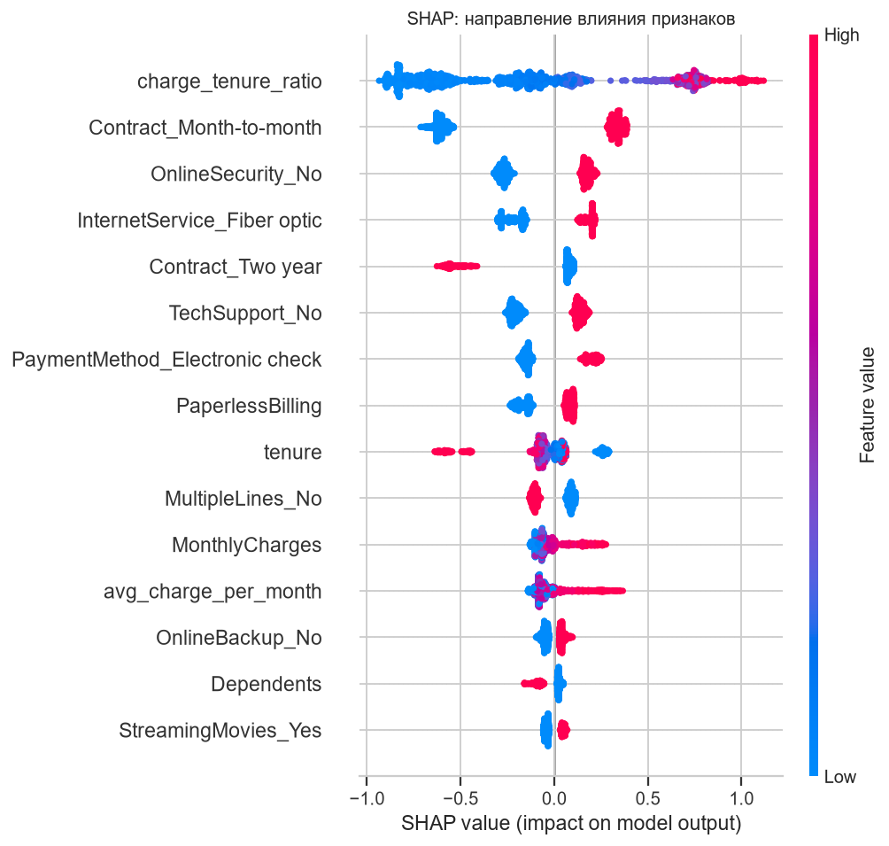

# Предсказание оттока клиентов (Telco Churn)

Сквозной классический ML-проект: от разведочного анализа до REST API.
Задача — предсказать вероятность ухода клиента телеком-оператора, чтобы
кампания удержания работала по адресу, а не по всей базе.

**Данные:** [Telco Customer Churn](https://raw.githubusercontent.com/IBM/telco-customer-churn-on-icp4d/master/data/Telco-Customer-Churn.csv) — 7043 клиента, 21 признак, доля оттока 26.5%.

---

## Результаты

Финальная модель — XGBoost с гиперпараметрами, подобранными Optuna.
Оценка на отложенной тестовой выборке (1409 клиентов), которая не участвовала
ни в отборе модели, ни в подборе гиперпараметров:

| Метрика | Значение | Комментарий |
|---|---|---|
| **ROC-AUC** | **0.847** | способность ранжировать клиентов по риску |
| **PR-AUC** | **0.661** | при базовой доле оттока 0.265 — в 2.5 раза лучше случайного |
| **F1** | **0.648** | при рабочем пороге 0.565 |
| Precision | 0.576 | из помеченных уходит каждый второй |
| Recall | 0.741 | ловим три четверти уходящих |
| Brier | 0.158 | вероятности откалиброваны, можно использовать как есть |
| Accuracy | 0.786 | приводится для справки — метрика обманчива при дисбалансе |

Матрица ошибок при пороге 0.565: TN=831, FP=204, FN=97, TP=277.

### Метрики, которые важнее accuracy

При дисбалансе 2.8:1 «предсказывать всем класс 0» даёт accuracy 0.735 и
recall 0. Поэтому смотрим на:

**Recall при заданной точности** — сколько уходящих поймаем, если допустимо,
чтобы не более X% срабатываний были ложными:

| Требуемая precision | Достижимый recall | Порог |
|---|---|---|
| ≥ 0.50 | 0.832 | 0.446 |
| ≥ 0.60 | 0.642 | 0.629 |
| ≥ 0.70 | 0.390 | 0.762 |
| ≥ 0.80 | 0.267 | 0.836 |

**Стратегии порога** — порог не «0.5 по умолчанию», а бизнес-решение:

| Стратегия | Порог | Охват базы | Precision | Recall | F1 |
|---|---|---|---|---|---|
| Минимум потерь (FN дороже FP в 10×) | 0.130 | 72% | 0.363 | **0.987** | 0.530 |
| Максимум F1 (рабочий порог) | 0.565 | 34% | 0.576 | 0.741 | **0.648** |
| Топ-20% по риску | 0.715 | 20% | 0.660 | 0.497 | 0.567 |
| Топ-10% по риску | 0.822 | 10% | **0.766** | 0.289 | 0.419 |

Формальный минимум потерь требует обзвонить 72% базы — колл-центр этого не
выдержит. Поэтому рабочим выбран F1-оптимум, а «топ-10%» — вариант, когда
ёмкость кампании жёстко ограничена. Выбор зависит от стоимости удержания
и пропускной способности, а не от математики.

---

## Что важно в этом проекте

**Честная валидация.** Тест отделён до подбора гиперпараметров. Optuna
оптимизировала ROC-AUC на стратифицированной кросс-валидации по train —
тестовая выборка не участвовала ни на одном шаге отбора.

**Логистическая регрессия обошла бустинги на дефолтных параметрах**
(0.8482 против 0.8374 ROC-AUC на CV). Это не ошибка, а следствие размера
данных: 5634 строки, много категориальных признаков — линейная модель с
регуляризацией здесь конкурентоспособна. Только после тюнинга XGBoost
вышел вперёд (0.8510 на CV, 0.8465 на тесте). Вывод, который стоит
проверять, а не предполагать: «бустинг всегда лучше» — неверно.

**Пропуск, закодированный строкой.** `TotalCharges` приходит как текст,
потому что 11 значений записаны пробелом. Если читать столбец «как есть»,
pandas молча сделает его строковым и модель упадёт либо даст мусор.
В `src/data.py` это обрабатывается явно: для клиентов с `tenure == 0`
ставится 0 (они ещё не платили), остальным — медиана.

**Инженерия признаков дала топ-1 сигнал.** Признак `charge_tenure_ratio`
(месячный платёж / срок + 1) занял первое место по SHAP с большим отрывом —
он ловит связку «дорогой тариф при коротком стаже». Без него модель
опиралась бы на коррелированную пару `MonthlyCharges` + `tenure` менее точно.

**Отсутствие утечки в пайплайне.** Инженерия признаков и обучение
статистик препроцессинга (медианы, one-hot словарь) происходят внутри
`sklearn.Pipeline` на train. Это проверяется тестом: среднее масштабированного
`tenure` по train близко к нулю, по test — нет.

---

## Что говорит модель (SHAP)

Топ-10 признаков по среднему |SHAP|:

| Признак | Вклад | Интерпретация |
|---|---|---|
| `charge_tenure_ratio` | 0.511 | дорогой тариф на коротком стаже — главный сигнал риска |
| `Contract_Month-to-month` | 0.456 | нет обязательств — легко уйти |
| `OnlineSecurity_No` | 0.224 | нет привязки через допуслугу |
| `InternetService_Fiber optic` | 0.205 | дорогой канал при плохом опыте |
| `Contract_Two year` | 0.191 | долгосрочный контракт снижает риск |
| `TechSupport_No` | 0.174 | нет техподдержки |
| `PaymentMethod_Electronic check` | 0.168 | ручная оплата вместо автоплатежа |
| `PaperlessBilling` | 0.118 | коррелирует с мобильным профилем |
| `tenure` | 0.105 | короткий срок обслуживания |
| `MultipleLines_No` | 0.096 | — |



Модель объясняет не только «сколько», но и «почему»: `src/explain.py` умеет
выдавать разбор по конкретному клиенту — топ-признаков, сдвинувших прогноз
в плюс или минус.

---

## Графики

| Файл | Содержание |
|---|---|
| `01_target_balance.png` | дисбаланс классов: 73.5% / 26.5% |
| `02_numeric_distributions.png` | распределения `tenure`, `MonthlyCharges`, `TotalCharges` по классам |
| `03_churn_rate_by_category.png` | доля оттока по категориям — где сконцентрирован риск |
| `04_correlation.png` | корреляции числовых признаков |
| `05_roc_curve.png` | ROC-кривая на тесте |
| `06_pr_curve.png` | Precision-Recall с базовым уровнем |
| `07_confusion_matrix.png` | матрица ошибок при рабочем пороге |
| `08_calibration.png` | калибровка вероятностей (Brier = 0.158) |
| `09_threshold_selection.png` | выбор порога: стоимость ошибок и метрики |
| `10_shap_importance.png` | важность признаков |
| `11_shap_beeswarm.png` | направление влияния признаков |

---

## Структура проекта

```
churn-ml/
├── data/
│   ├── raw/telco_churn.csv          # исходные данные
│   └── processed/                   # train.csv / test.csv (фиксированный split)
├── models/churn_model.joblib        # пайплайн + порог + метаданные
├── reports/
│   ├── eda_report.md                # отчёт EDA
│   ├── model_comparison.md          # таблица CV-сравнения
│   ├── metrics.json                 # метрики на тесте
│   ├── shap_importance.csv          # важность признаков
│   ├── shap_examples.json           # разбор конкретных клиентов
│   └── figures/                     # 11 графиков
├── src/
│   ├── config.py                    # пути, константы, стоимость ошибок
│   ├── eda.py                       # разведочный анализ
│   ├── data.py                      # загрузка, очистка, split
│   ├── features.py                  # пайплайн признаков (без утечки)
│   ├── train.py                     # сравнение моделей, 5-fold CV
│   ├── tune.py                      # Optuna
│   ├── evaluate.py                  # финальная оценка, порог, графики
│   ├── explain.py                   # SHAP, объяснение клиента
│   ├── predict.py                   # инференс-модуль
│   ├── api.py                       # FastAPI-сервис
│   └── pipeline.py                  # всё одной командой
└── tests/                           # 50 тестов pytest
```

---

## Запуск

```bash
# 1. Окружение
python -m venv .venv
.venv\Scripts\activate            # Windows
pip install -r requirements.txt

# 2. Полный пайплайн: данные -> CV -> модель -> оценка -> SHAP  (~22 секунды)
python -m src.pipeline

# 3. Тесты
pytest

# 4. Скоринг из командной строки
python -m src.predict --top 20
python -m src.predict --customer-id 5178-LMXOP

# 5. REST API
uvicorn src.api:app --host 127.0.0.1 --port 8000
```

Отдельные шаги: `python -m src.eda`, `python -m src.data`, `python -m src.features`,
`python -m src.train --tune --n-trials 60`, `python -m src.tune --trials 50`,
`python -m src.evaluate`, `python -m src.explain`.

### API

Swagger-документация: `http://127.0.0.1:8000/docs`

```bash
curl -X POST http://127.0.0.1:8000/predict \
  -H "Content-Type: application/json" \
  -d '{"customerID":"TEST-001","tenure":2,"MonthlyCharges":95.5,"TotalCharges":191.0,
       "Contract":"Month-to-month","InternetService":"Fiber optic","TechSupport":"No"}'
```

```json
{
  "customerID": "TEST-001",
  "churn_probability": 0.9083,
  "churn_prediction": 1,
  "risk_band": "критический",
  "threshold": 0.565,
  "model_roc_auc": 0.8465
}
```

Эндпоинты: `GET /health`, `GET /model/info`, `POST /predict`,
`POST /predict/batch` (до 1000 клиентов за запрос, с агрегированной сводкой).

Модель грузится один раз при старте приложения, а не на каждый запрос.
Валидация входных данных — через pydantic: отрицательный `tenure` вернёт
422 с описанием ошибки, а не 500.

---

## Тесты

50 тестов, `pytest` — около 4 секунд:

- **`test_data.py`** — очистка, идемпотентность, кодирование целевой
  переменной, стратификация, воспроизводимость split, отсутствие пересечений;
- **`test_features.py`** — отсутствие утечки, устойчивость к невиданным
  категориям и к пробелам в `TotalCharges`, отсутствие `inf` при делении на
  ноль, неизменность входных данных;
- **`test_predict.py`** — диапазон вероятностей, порядок выхода, пакетный
  скоринг = одиночный, осмысленность (рискованный клиент скорится выше
  лояльного, риск падает с ростом стажа), санити-чек качества модели;
- **`test_api.py`** — схемы ответов, валидация входных данных, пакетный
  эндпоинт, сохранение порядка.

Тесты, которым нужна обученная модель, помечены `needs_model` и
пропускаются, если артефакт ещё не собран.

---

## Ограничения и что дальше

**Ограничения.** Датасет синтетический и небольшой (7043 строки) —
абсолютные значения метрик не переносятся на реальный бизнес. Модель
обучена на срезе без временной динамики: в проде нужна валидация по
времени (train на прошлом, test на будущем), иначе метрики завышены.
Стоимость ошибок (10:1) задана как допущение — её должен дать бизнес.

**Направления развития:**
- валидация по времени вместо случайного split;
- uplift-моделирование вместо предсказания оттока: важно не «кто уйдёт»,
  а «на кого повлияет предложение удержания»;
- мониторинг дрейфа данных и деградации метрик в проде;
- инкрементальное обучение и версионирование моделей (MLflow);
- байесовская калибровка, если вероятности пойдут в расчёт LTV.
